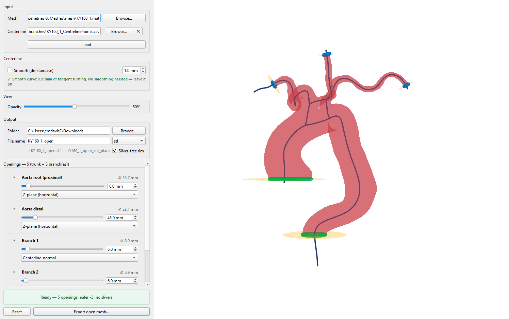

# Vascular Cut Tool

Interactive, centerline-driven cutting of vascular surface meshes into **open**
meshes. Load a closed thoracic-aorta mesh and its centerline, drag a slider per
opening to place each cut, and export an open mesh with clean planar inlets and
outlets, ready for a downstream flow solver.



It handles both **branched** aortas (root, distal, and each arch-branch opening)
and **unbranched** ones (two planes isolating a length of trunk), and it works
out the tree, which end is which, and how to cut each opening automatically from
the geometry, nothing is hard-coded to one dataset.

---

## For collaborators, you were handed `vascular-cut.zip`

1. **Unzip it** anywhere on your computer → you get a `vascular-cut` folder.
2. **Check one prerequisite is present:** either **conda** (Anaconda / Miniforge)
   **or Python 3.10–3.12**. Most lab machines have one; the launcher finds it.
   You also need internet the first time.
3. **Launch:** double-click **`run.bat`** (Windows) or run **`./run.sh`**
   (macOS / Linux). The first run sets everything up (a few minutes); every run
   after is instant.

That's it, the step-by-step with pictures is in
[`docs/User-Guide.pdf`](docs/User-Guide.pdf). The rest of this file is the
detailed / alternative setup routes.

## Quick start

Pick whichever of the three routes matches your setup. **All three do the same
thing**; conda is the most reliable on managed/institutional machines, which is
why it is listed first.

Sample data (a real branched aorta, `KY160_1`) ships with the tool, so you can
try it the moment it launches.

### Option A, conda *(recommended)*

If you have Anaconda / Miniforge (common on lab machines):

```bash
conda env create -f environment.yml
conda activate vascular-cut
python branch_gui.py
```

### Option B, one-click launcher

No terminal needed. The launcher sets everything up on first run (a few
minutes), then launches instantly every time after. It uses conda if present,
otherwise builds a local environment.

- **Windows:** double-click **`run.bat`**
- **macOS / Linux:** `./run.sh`  (first: `chmod +x run.sh`)

### Option C, pip + venv

If you already have Python **3.10, 3.11, or 3.12**:

```bash
python -m venv .venv
# Windows:
.venv\Scripts\activate
# macOS / Linux:
source .venv/bin/activate

pip install -r requirements.txt
python branch_gui.py
```

> **Python version matters.** Use **3.10–3.12**. Python 3.13+ is not yet
> supported, several dependencies have no wheels there and the install will
> fail. The conda route and the launchers handle this for you.

---

> 📄 **Printable user guide:** [`docs/User-Guide.pdf`](docs/User-Guide.pdf), an
> illustrated, hand-out-ready walkthrough of the interface.

## Using the tool

1. **Load.** Browse to a surface **Mesh** (`.mat`, `.stl`, `.ply`, `.obj`) and,
   to cut it, a **Centerline** (`.csv`). Leave the centerline blank to just view
   a mesh. Click **Load**. (Both sample files are in the project root:
   `Geometries & Meshes/mesh/KY160_1.mat` and `KY160_1_CentrelinePoints.csv`.)

2. **Place each cut.** Every opening has a row with a slider and an exact-mm box
  , drag for feel, type for precision. The number is how far back from the
   vessel tip the cut sits. The 3-D view updates the cut planes live and the
   mesh re-cuts when you release.

3. **Fine-tune (optional).** Click the ▸ on a row to reveal **Tilt** and
   **Plane size** for that cut. Shrinking the plane size fixes the occasional
   case where one cut punches two holes on a very tortuous branch.

4. **Watch the status bar.** Green means a valid, clean cut. Red names the
   problem and how to fix it (e.g. *"the cut plane meets the vessel at 66°, it
   is slicing along the vessel rather than across it. Switch it to
   Centerline-normal."*). Export is blocked while it is red.

5. **Export.** Set an output **Folder** and **File name**, pick a format, and
   click **Export open mesh…**. You get the open mesh plus a
   `<name>_cut_planes.json` recording every cut plane, offset, tilt and
   resulting diameter. Folder, format and name are remembered between sessions.

### Cut modes

- **Z-plane (horizontal)**, matches how the aorta ends are usually cut in
  segmentation. Auto-selected for trunk ends when their existing cap is
  near-horizontal.
- **Centerline-normal**, perpendicular to the vessel. Auto-selected for
  branch tips, and the safe choice anywhere the vessel runs at an angle.

### Jagged centerlines

If a centerline is a **voxel staircase** (e.g. a raw geodesic path), the
**Centerline → Smooth (de-staircase)** box is offered automatically and the
readout warns you. Smoothing fits a spline through the points, removing the
staircase without moving the line off-centre. Centerlines that are already
smooth (e.g. Simpleware / Scan-IP splines) are flagged as fine and left
**exactly** as supplied, nothing is smoothed unless you ask.

---

## What's in the project

| File | Purpose |
|---|---|
| `branch_gui.py` | The GUI (entry point). |
| `branch_cut.py` | Cutting, validation, mesh I/O. |
| `branch_tree.py` | Centerline parsing, the vessel tree, cut-plane geometry. |
| `requirements.txt` | Pinned dependencies (the authoritative list). |
| `environment.yml` | Conda environment. |
| `pyproject.toml` | Makes the tool `pip install`-able as `vascular-cut`. |
| `run.bat` / `run.sh` | One-click launchers. |
| `vascular_api.py` | The cut tool with no Qt, what the web apps and any script drive. |
| `shape_metrics.py` | Curvature fluctuation (δK) for any surface. |
| `camp/` | The lab's CAMP partition, vendored verbatim, see `camp/README.md`. |
| `webapp/cut_app.py` | The site: cutting and δK, in a browser (trame), on the desktop tool's 3-D pipeline. |
| `webapp/shape.py` | Runs a δK job and turns the result into something the 3-D view can draw. |
| `shape_worker.py` | One δK job, in a process of its own. See the note below. |
| `webapp/app.py` | The plain Streamlit version, superseded by `cut_app.py`. |
| `webapp/scene.py` | The web app's 3-D scene, built to match the desktop window's. |
| `tests/` | Regression suites, see `tests/README.md`. |
| `KY160_1_*`, `KK2_5.*` | Sample aortas (a branched and an unbranched case). |
| `cl.py`, `cutclean.py` | Centerline generation and uniform remeshing. |

Once installed via `pip install .`, the GUI is also available as a command:

```bash
vascular-cut                          # opens empty; pick files in the UI
vascular-cut centerline.csv mesh.mat  # opens with a case loaded
```

---

## The web front end

```bash
webapp\run_cut.bat        # Windows
# or, anywhere:
python webapp/cut_app.py
```

Then open **http://127.0.0.1:8080**. Two sections on one page, switched from the
toolbar, sharing a session and a viewport.

### Cut and export

The same VTK pipeline the desktop window uses: a PyVista plotter rendered on the
server and streamed to the browser by [trame](https://kitware.github.io/trame/).
That is what keeps the cut planes live and draggable rather than settling for a
static re-cut. The panel mirrors the desktop layout deliberately, same groups in
the same order, same wording, same ranges, so anything that reads differently
there is a bug rather than a redesign.

Two things both front ends carry that are worth knowing about:

- **Declaring an artery.** Each opening's name box is a list as well as a text box.
  Typing relabels it; picking from the list *declares* which artery it is, and the
  region presets are built from that. On an abdominal aorta a declared renal is what
  brings back Aortic neck, Infrarenal aorta and Infrarenal aorta with iliacs. Across
  47 abdominal scans the rules name no renal on 18, and on 14 of those because
  several lateral pairs fit equally well — naming either would be a guess presented
  as a fact, so neither is named. A declaration displaces the automatic name of the
  same artery, so "the lowest renal" cannot land on the vessel being corrected. See
  [`tools/ABDOMINAL.md`](tools/ABDOMINAL.md).
- **The nub-in preset.** One action sets every opening: each branch cut back to a
  stub 0.75 of its own radius past the aortic wall, and the aorta's own ends squared
  off horizontally. That figure was measured over 82 vessels in 30 cases — a branch
  leaves as a funnel and a plane through a funnel does not come back flat, so each
  vessel has a shortest nub it can take. A nub that will not cut cleanly is moved
  *outward* until it does, never inward, and every rescue is reported. Refused while
  a region is isolated, since the preset squares off ends a region has replaced.

### Shape metrics, δK

Choose a surface, get δK. CAMP, the lab's patch partition behind δK, is vendored
under [`camp/`](camp/) as a verbatim copy with its provenance and hash in
[`camp/README.md`](camp/README.md), so this works from a fresh clone.

The two sections do not depend on each other. **Use the cut in this session** hands
the surface straight over without a download and an upload, but the section takes any
open triangular mesh, so a collaborator who already has geometries never has to touch
the cut tool.

What is on screen is the partition itself, coloured by integrated K, by each patch's
deviation from the area-weighted mean (which is what δK is the variance of), by
Gaussian curvature, by Monge fit quality, or by patch identity. **Patch outlines**
draws the partition boundaries, which is the only way to see how the surface was
actually divided: two neighbouring patches with similar curvature are the same colour
and the seam between them is otherwise invisible.

δK is extensive and partition dependent, so the panel says what it was computed
under (face count, trim, CAMP build) and warns whenever any of that leaves the
reference cohort's operating point. A δK without those conditions cannot be compared
to another one.

**It is also not reproducible to better than a factor.** CAMP rebuilds its partition
from scratch on every run, so remeshing the same geometry to 98k faces instead of 100k
changes the answer even though not one vertex of the anatomy moved: by 2.6× typically
at trim 0, and by 23.5× on the worst of 30 cases. That is why the reference trim is
0.0025 rather than 0 — it brings the spread down to 1.6× typical, 3.8× worst, while
discarding half a per cent of patches. Both front ends print this band beside the trim
control and again under the result, so a difference smaller than it is not read as a
finding. The measurements, the two repair approaches that failed, and why patches that
fail to converge are never dropped are all in [`CURVATURE.md`](CURVATURE.md).

Both front ends also check the **source surface for folds** — faces meeting at more
than 90°, where the surface doubles back through itself — and say so before the run.
14 of the 30 reference meshes carry them, they come from the segmentation rather than
from anything here, and they are reported rather than corrected: across that cohort
their count does not predict how much δK moves between runs (r = −0.07).

Two things worth knowing:

- **It runs in a separate process.** ACVD and CAMP are VTK underneath, and running
  them on a worker thread beside a live render window segfaults the interpreter.
  [`shape_worker.py`](shape_worker.py) is that process; a CAMP failure comes back as
  a message on the panel rather than a dead server.
- **It takes 10 to 40 seconds**, longer at 200,000 faces. The panel reports the phase
  and elapsed time while it works, and it can be cancelled.

To run against a different build of CAMP without touching the repository:

```powershell
$env:CAMP_SRC = "C:\path\to\other\campsrc.py"
```

### The plain Streamlit version

[`webapp/app.py`](webapp/app.py) predates the above and covers the same ground with
no live cut planes and no 3-D patch view. It is kept because it needs no VTK render
window, so it runs where `cut_app.py` will not.

```bash
webapp\run.bat            # Windows, then open http://127.0.0.1:8501
```

Uploads there are written to a per-session temporary directory and deleted when the
session ends. Nothing is retained.

### Neither of them is authenticated

`.streamlit/config.toml` binds Streamlit to `127.0.0.1`, and `cut_app.py` binds to
the same address and **refuses to start** on any other unless `VC_PUBLIC=1` is set.
That matters: either would otherwise listen on every interface, which raises a
Windows Firewall prompt and puts an app with **no authentication** on your
institution's network. Worse, the input here is a file *path*, so a routable binding
makes anything the server account can read readable remotely. If you ever see a
firewall dialog starting one of these, don't allow it, check the binding first.

### What it does not do yet

A local tool served to a browser, not a hosted service. It takes file **paths**
rather than uploads, writes its exports to `output/` on the machine running it, and
trame's built-in server handles one session at a time, so a tab left open elsewhere
will stop the next one mounting. Set `VC_CUT_PORT` to run a second copy beside the
first. The cut section also has no trim controls yet, which the desktop window does
have.

---

## Troubleshooting

- **The install fails building a package / "no matching distribution".** You are
  almost certainly on Python 3.13+. Use 3.10–3.12 (or the conda route).

- **The window is black, or "failed to create OpenGL context".** The 3-D view
  needs a real GPU/OpenGL context. Over Remote Desktop or a headless SSH session
  it may not get one, run it on the machine directly, or enable GPU/3-D
  acceleration in your remote client.

- **"Could not load … no header row containing 'Position x (global)'".** The
  CSV isn't a recognised centerline export. The tool reads two dialects:
  Simpleware per-data-point spline exports (with a `Spline name` column) and
  `cl.py`'s `save_centerline_csv` output (`Tangent x/y/z` columns).

- **A `.mat` mesh won't load.** It must contain `<name>_surface_vertices` and
  `<name>_surface_triangles` (Simpleware's surface export format); the `<name>`
  prefix is detected automatically.

- **The trunk/branch labels look wrong.** They are a geometric guess (by vessel
  calibre and height). Rename any opening by editing its name, and switch its
  cut mode with the dropdown, nothing is fixed.
